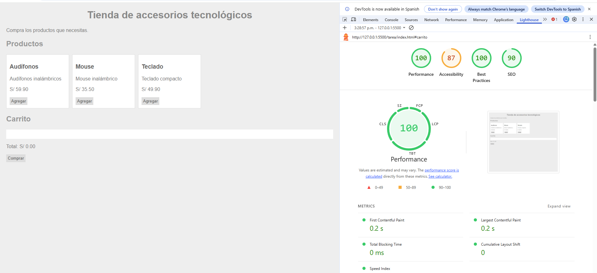
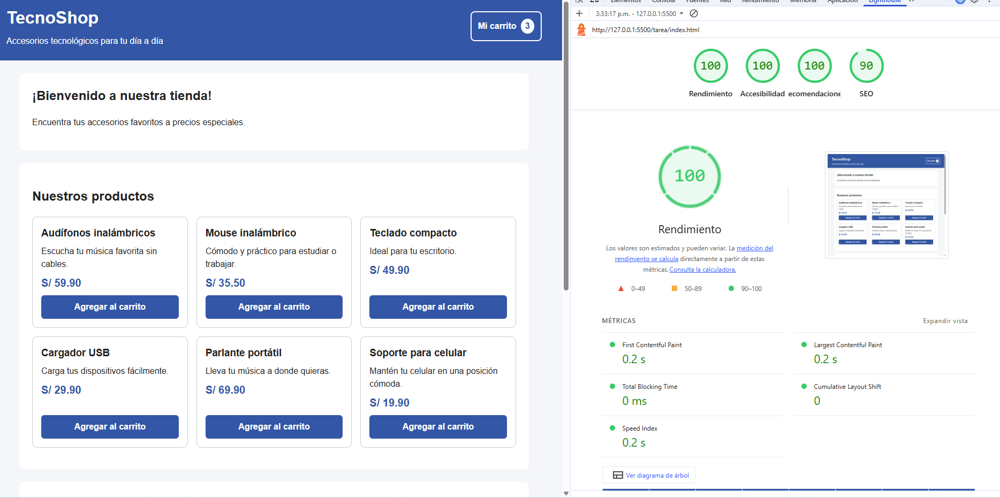

# Auditoría UX/UI - TecnoShop

## 1. Descripción del proyecto

TecnoShop es una tienda virtual simulada de ejemplo que permite a los usuarios
revisar productos tecnológicos, agregarlos a un carrito y ver el total
de su compra

El objetivo de este trabajo es mejorar la facilidad de uso de la tienda,
para que las personas puedan encontrar productos y realizar sus acciones
sin confundirse

## 2. Auditoría de la interfaz

| Heurística | Problema de la versión original | Solución aplicada |
|---|---|---|
| Visibilidad del estado del sistema | Al agregar un producto, no se mostraba un mensaje claro que indicara si se había agregado correctamente. | Se agregó un mensaje visible que confirma cuando un producto se agrega al carrito. |
| Coincidencia entre el sistema y el mundo real | Algunas acciones podían tener nombres poco claros para una persona que visita una tienda virtual. | Se usaron palabras sencillas y conocidas, como “Agregar al carrito”, “Eliminar” y “Finalizar compra”. |
| Control y libertad del usuario | Al quitar un producto, la persona podía hacerlo por error sin confirmar la acción. | Se agregó una confirmación antes de eliminar un producto del carrito. |
| Prevención de errores | Se podía intentar finalizar una compra sin haber agregado productos. | Se deshabilitó el botón de compra cuando el carrito está vacío y se muestra un aviso cuando corresponde. |
| Reconocer en lugar de recordar | La persona podía perder de vista qué productos había elegido y cuánto debía pagar. | Se agregó una sección de carrito que muestra los productos, sus cantidades y el total de la compra. |

## 3. Cambios aplicando las leyes de usabilidad

### Ley de Fitts

Se aplicó haciendo que los botones principales tengan un tamaño adecuado
y sean fáciles de encontrar y presionar.

Por ejemplo, el botón “Agregar al carrito” tiene un tamaño cómodo
para hacer clic, incluso desde una pantalla pequeña.

### Ley de Hick

Se aplicó organizando la tienda para que las acciones sean claras
y no se presenten demasiadas opciones al mismo tiempo.

La persona puede revisar los productos y elegir si desea agregarlos
al carrito, sin tener que pasar por muchos pasos.

### Ley de Miller

Se aplicó agrupando la información de cada producto en una tarjeta
con su nombre, descripción, precio y botón.

De esta manera, la información se presenta ordenada y es más fácil
de revisar.

## 4. Mejoras de accesibilidad y diseño

Se realizaron los siguientes cambios:

- Se definieron colores mediante variables CSS dentro de `:root`.
- Se usó un espaciado uniforme entre las secciones.
- Se agregaron botones con una altura mínima de 44 píxeles
- Se incluyó un borde visible cuando se navega con el teclado.
- Se usaron textos sencillos ain tecnsismsos para identificar las acciones.
- Se adaptó el diseño para pantallas pequeñas.
- Se muestran mensajes después de realizar acciones importantes.
- Confirmación antes de eliminar productos.
- Se evita finalizar una compra cuando el carrito está vacío

## 5. Capturas de pantalla

### 5.1. Interfaz antes del rediseño

### 5.2. Interfaz después del rediseño

